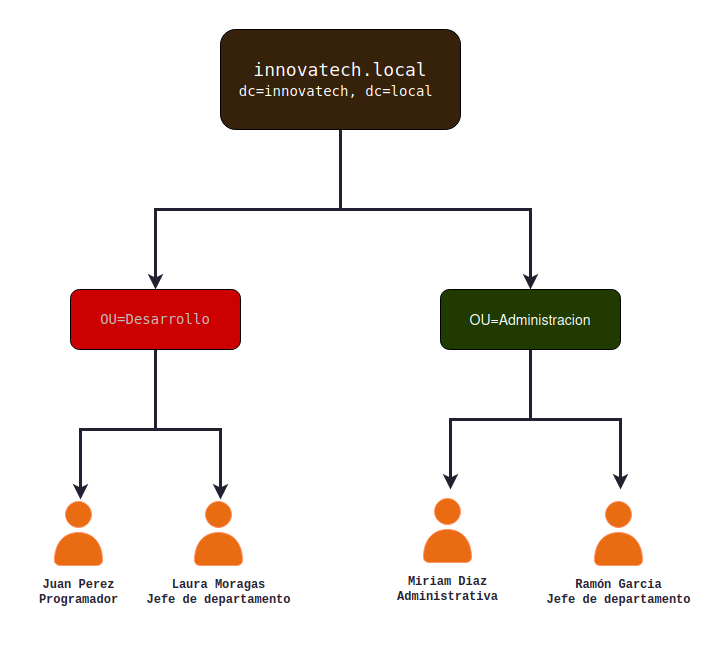
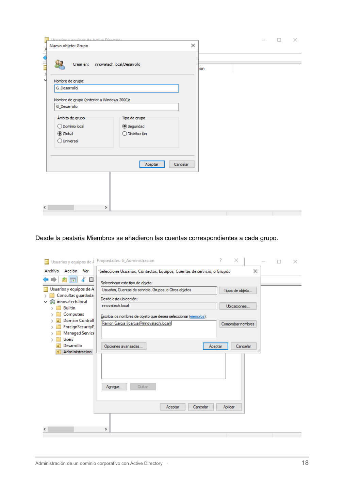
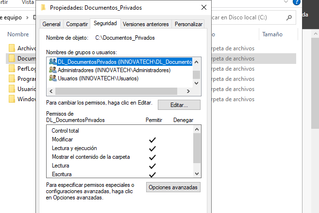
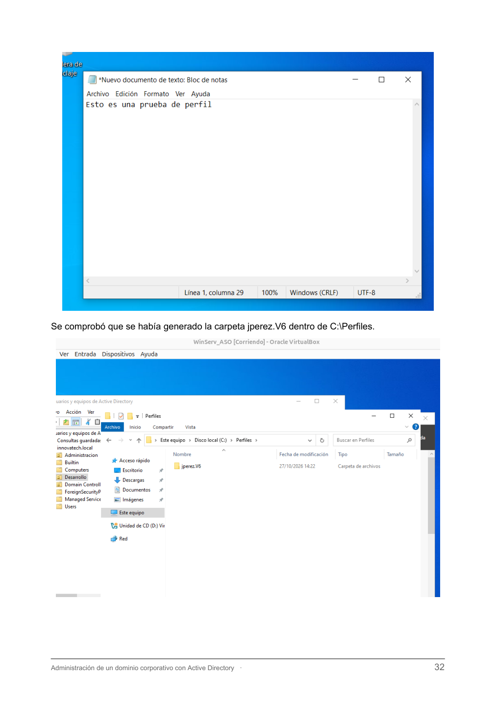
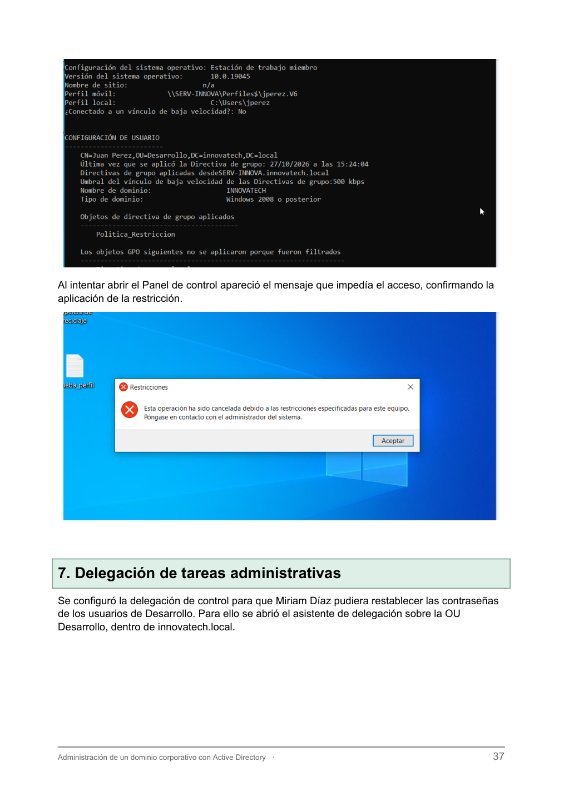

# Administración de un dominio corporativo con Active Directory

**Mini Lab · Windows Server 2022 · Active Directory · GPO · PowerShell**

Se ha montado un dominio de Active Directory para **InnovaTech**, una empresa ficticia con dos departamentos: **Desarrollo** y **Administración**. El objetivo ha sido centralizar la gestión de usuarios y controlar el acceso a recursos compartidos desde un servidor Windows.

> **Entorno:** Windows Server 2022 y cliente Windows en máquinas virtuales VirtualBox.  
> **Dominio:** `innovatech.local` · **Servidor:** `SERV-INNOVA` · **IP del servidor:** `192.168.50.10/24`.

## 1. Estructura del dominio

Se ha instalado el rol **AD DS** junto con DNS y se ha creado el dominio `innovatech.local`. Después se han organizado los usuarios en dos unidades organizativas (OU), una por departamento, y se han creado grupos globales de seguridad para gestionar sus accesos.



## 2. Usuarios y grupos de seguridad

Se han creado cuatro cuentas de prueba, con cambio de contraseña obligatorio en el siguiente inicio de sesión. Los usuarios se han incorporado a `G_Desarrollo` o `G_Administracion` según su departamento.

También se han comprobado los objetos del dominio con PowerShell:

```powershell
Get-ADUser -Filter *
Get-ADUser -Identity jperez
```



## 3. Permisos sobre carpetas compartidas

Se ha creado la carpeta `C:\Documentos_Privados` para el departamento de Desarrollo. Los permisos de recurso compartido y NTFS se han asignado mediante grupos, en lugar de configurarlos usuario por usuario.

Desde el cliente se ha comprobado que un usuario de Desarrollo podía **crear y modificar un archivo** en la carpeta compartida.



**Detalle pendiente:** se tomó como referencia el modelo AGDLP, pero quedó por revisar el ámbito del grupo `DL_DocumentosPrivados`, que aparecía como **Global** en la captura. También faltó probar el acceso con un usuario de otro departamento.

## 4. Perfiles móviles

Se ha compartido `C:\Perfiles` como `Perfiles$` y se ha configurado para una cuenta la ruta:

```text
\\SERV-INNOVA\Perfiles$\%username%
```

Tras cerrar la sesión del cliente, se ha comprobado la creación de la carpeta de perfil `jperez.V6` en el servidor.



Quedó pendiente comprobar la recuperación del perfil desde otro cliente y revisar el aislamiento de las carpetas de cada usuario.

## 5. Directivas de grupo (GPO)

Se ha creado la GPO `Politica_Restriccion` y se ha vinculado a la OU **Desarrollo**. La directiva impide acceder al Panel de control y a Configuración de PC.

En el cliente se ha actualizado la política y comprobado su aplicación:

```cmd
gpupdate /force
gpresult /r
```

Al intentar abrir el Panel de control, Windows mostró el mensaje de restricción, confirmando que la GPO se estaba aplicando.



## 6. Otras tareas y límites de las pruebas

También se ha preparado un archivo **LDIF** para una cuenta y se ha configurado una **delegación** para restablecer contraseñas de usuarios de Desarrollo. En la documentación original no se incluye una importación LDIF ni una prueba funcional iniciando sesión con la cuenta delegada; por tanto, estas tareas se presentan como configuraciones realizadas, **no como pruebas completadas**.

## Resultado

El laboratorio ha permitido pasar de un servidor recién instalado a un dominio con usuarios organizados, grupos de seguridad, carpetas compartidas, perfiles móviles y una GPO aplicada y verificada desde un cliente.

Se ha comprobado el acceso autorizado a la carpeta, el guardado del perfil en el servidor y el bloqueo del Panel de control. Las comprobaciones pendientes quedan identificadas para futuras ampliaciones.

---

**[Consultar la documentación completa (PDF)](docs/active-directory.pdf)** — Memoria original con el proceso y las capturas de las pruebas.

*Laboratorio realizado durante el CFGS de Administración de Sistemas Informáticos en Red (ASIR). Entorno ficticio de prácticas.*
